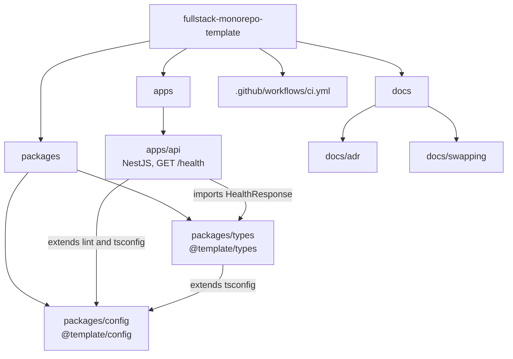

# fullstack-monorepo-template

A TypeScript monorepo you can build a fullstack app on: pnpm workspaces, Turborepo, a NestJS API, shared config and shared types, git hooks and CI. Click **Use this template** and you start with a working `GET /health`.

It accompanies the blog series **Build, Measure, Learn: Tech & Data** on Hashnode. Each post adds one layer and gets one git tag, so you can check out the exact state a post describes.

| Tag      | Adds                                              |
| -------- | ------------------------------------------------- |
| `v0.1.0` | Monorepo foundation and NestJS API (this version) |

## Why a monorepo

The API and its clients share types, lint rules and TypeScript settings. In one repository a change to a contract fails the build of every consumer in the same pull request.

## Requirements

- Node.js 24.15.0 or newer (see `.node-version`)
- pnpm 12.14.0 (`packageManager` in `package.json`). Run `corepack enable` and the right version is used.

## Quick start

```bash
pnpm install
pnpm dev
```

In another terminal:

```bash
curl localhost:3000/health
# {"status":"ok","timestamp":"2026-10-19T16:48:03.366Z"}
```

Set `PORT` to use another port.

Before you push, run everything CI runs:

```bash
pnpm check
```

## Repo layout



## Scripts

Run from the repository root. Turborepo runs each one in every package that defines it, in dependency order, and caches the result.

| Script           | What it does                                       |
| ---------------- | -------------------------------------------------- |
| `pnpm dev`       | Start the API in watch mode                        |
| `pnpm build`     | Compile every package to `dist/`                   |
| `pnpm lint`      | ESLint in every package                            |
| `pnpm typecheck` | `tsc --noEmit` in every package                    |
| `pnpm test`      | Vitest (unit and e2e)                              |
| `pnpm check`     | `lint`, `typecheck`, `test` and `build` in one run |
| `pnpm format`    | Prettier over the whole repo                       |

Limit a run to one package and what it depends on:

```bash
pnpm turbo run build --filter=@template/api
```

## Guardrails

- **Pre-commit** (husky + lint-staged): ESLint and Prettier on staged files, then `pnpm typecheck`.
- **Commit message** (commitlint): [Conventional Commits](https://www.conventionalcommits.org), lowercase subject, no trailing period, 72 characters at most.
- **Install scripts are denied** in `pnpm-workspace.yaml` (`allowBuilds`). Allow one only after checking that the package needs it.

## Use it as your own

1. Create a repository from this template.
2. Rename the `@template/` scope in `package.json` files, imports and `tsconfig` extends.
3. Run `pnpm install && pnpm check`.

## Docs

- [Architecture decisions](docs/adr)
- [How to swap a library or tool](docs/swapping): [monorepo tooling](docs/swapping/monorepo-tooling.md), [API framework](docs/swapping/api-framework.md)

## License

[MIT](LICENSE)
